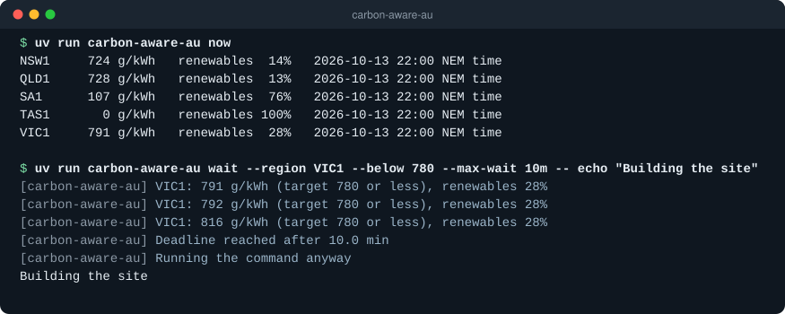
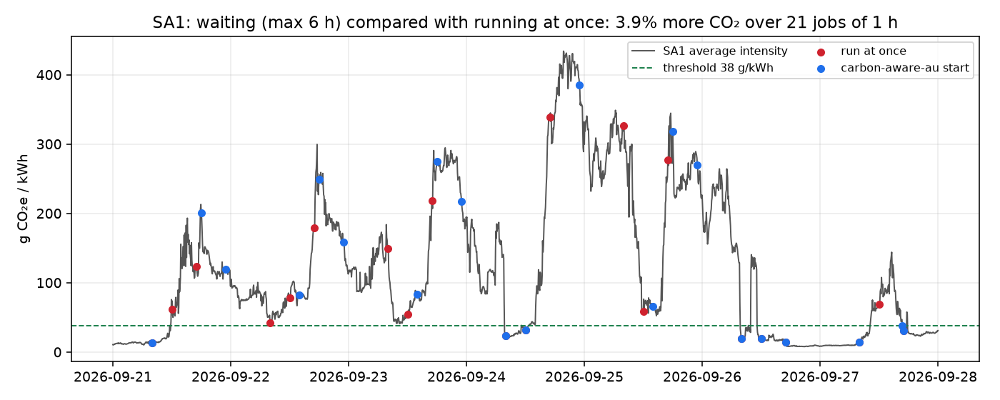

# carbon-aware-au

Run a command or a CI job when the grid in your Australian NEM region is cleaner.

[](https://github.com/Guinerve/carbon-aware-au/actions/workflows/ci.yml)
[](LICENSE)



*Real output from 13 October 2026 at 10 pm NEM time. The `wait` run checked VIC1 three times in 10 minutes, reached the deadline and then ran the command.*

carbon-aware-au is a command line tool and a GitHub Action. It reads AEMO's live 5 minute generation data and calculates the emissions intensity of generation in a NEM region. The `wait` command holds a job until the intensity falls to your threshold or below, or until a deadline. Then it runs the job.

I built it to find out if moving CI jobs and cron tasks to cleaner hours cuts emissions in Australia. On average, the intensity estimate is within 2.8 % of AEMO's published daily figures. The simple threshold policy does not help yet. In a replay of one week, it gave more CO₂ than running at once in 4 of 5 regions. The [results](#results) explain why.

## Quick start

You need [uv](https://docs.astral.sh/uv/) and Python 3.11 or later. The tool reads public AEMO data, so it needs no account and no key.

```bash
git clone https://github.com/Guinerve/carbon-aware-au
cd carbon-aware-au
uv sync
uv run carbon-aware-au now
```

To hold a command until South Australia is at 150 g CO₂e/kWh or less, for 3 hours at most:

```bash
uv run carbon-aware-au wait --region SA1 --below 150 --max-wait 3h -- echo "Deploying now"
```

Put your own command after `--`. Some notes on the options:

- `--below` is in g CO₂e/kWh. 400 g/kWh is the same as 0.4 t/MWh.
- `--region` takes NSW1, QLD1, VIC1, SA1 or TAS1. NSW, QLD, VIC, SA and TAS also work.
- At the deadline, the tool runs the command anyway. Use `--on-timeout fail` to exit with code 1 instead.
- If it cannot read AEMO data, it also runs the command. Use `--on-unavailable fail` to stop instead.
- The exit code is the exit code of your command.

## GitHub Action

The Action waits, then lets the next steps of the job run. I have not tested it on GitHub yet.

```yaml
steps:
  - uses: Guinerve/carbon-aware-au@main
    with:
      region: SA1
      below: 150
      max-wait: 3h
  - run: ./deploy.sh
```

A runner that waits still uses your Actions minutes. GitHub also stops a job after 6 hours by default.

## How it works

1. The tool downloads the latest `Dispatch_SCADA` report from AEMO NEMWeb. It gives the output in MW of each generating unit.
2. It joins each unit to AEMO's CDEII emissions factor for that unit, in t CO₂e/MWh.
3. For one region, intensity = sum(MW × factor) ÷ sum(MW). Units that charge (negative MW) are not counted.
4. `wait` checks again every 5 minutes, because AEMO publishes new data every 5 minutes.

The data client is the `nem` package from [nem-mcp](https://github.com/Guinerve/nem-mcp). uv installs it from GitHub.

## Results

### The estimate matches AEMO's published figures

I compared the daily average for each region with AEMO's published CDEII daily summary. The test covers 7 days (21 to 27 September 2026) in 5 regions, so 35 region days. Output: [`docs/validation-2026-09-21_27.txt`](docs/validation-2026-09-21_27.txt).

| Measure | Result |
|---|---|
| Mean absolute error | 9.6 g/kWh |
| Mean absolute percentage error | 2.8 % |
| Correlation | 0.9993 |
| Largest error in g/kWh | VIC1 on 27 September: 44 g/kWh high (7.5 %) |

The estimate is usually a little high. I use gross SCADA output, and CDEII uses energy sent out from each station.

### A fixed threshold does not cut emissions yet

I replayed the same week with the real 5 minute data. Each day had three 1 hour jobs, requested at 08:00, 12:00 and 17:00. Each job could wait for 6 hours at most. The threshold was the 30th percentile of the week before, so the replay did not use future data. Output: [`docs/simulation-all-regions.txt`](docs/simulation-all-regions.txt).

| Region | `wait` compared with running at once | Best possible start in the window |
|---|---|---|
| NSW1 | 9.5 % more CO₂ | 3.1 % less |
| QLD1 | 4.7 % more CO₂ | 2.9 % less |
| VIC1 | 0.7 % more CO₂ | 9.1 % less |
| SA1 | 3.9 % more CO₂ | 30.4 % less |
| TAS1 | 7.6 % less CO₂ | 26.5 % less |

The last column uses hindsight. It is the cleanest start inside each 6 hour window, so it shows the most that waiting could save.



The policy waits for the first reading below the threshold. On many days that reading does not come, and the job runs at the deadline. Between 8 and 19 of the 21 jobs in each region reached the deadline. The deadline is often a bad time to start:

- In NSW1 and QLD1, all 7 jobs requested at 17:00 waited through the evening peak and ran at 23:00. Those jobs caused most of the loss.
- In SA1, the midday jobs averaged 62 g/kWh if they ran at once. They waited for a reading below 38 g/kWh, and 4 of 7 ran at the deadline in the evening. They averaged 143 g/kWh.

There is a real saving to get, mostly in SA1 and TAS1. To get it, the tool must predict the clean hours, not wait for them.

## Limits

- The intensity is an average for local generation, not a marginal figure.
- It ignores power that a region imports from its neighbours. This matters most for SA1, TAS1 and VIC1.
- It does not include rooftop solar.
- Units that are not in AEMO's CDEII generator list are left out.
- It uses gross unit output, not output sent out from the station.
- For past days, the replay uses the current generator list from AEMO.
- The validation and the replay cover one week in September 2026 only.

## Roadmap

- Choose the start time from a typical day profile for each region, or from AEMO's predispatch forecast. Then run the replay again.
- Add a `plan` command that shows the cleanest start in the next few hours.
- Test the Action on GitHub.

## Development

```bash
uv sync
uv run pytest -q
uv run ruff check .
```

The 30 tests use fake data, so they do not need the network. To run the validation and the replay again (they download AEMO archive files):

```bash
uv run python scripts/validate.py 2026-09-21 2026-09-22
uv run python scripts/simulate_week.py SA1 2026-09-21 7
```

AEMO's current CDEII summary keeps recent days only, so `validate.py` works only for dates in that window. The replay needs matplotlib, which is in the dev group.

## Licence

MIT. See [LICENSE](LICENSE).
